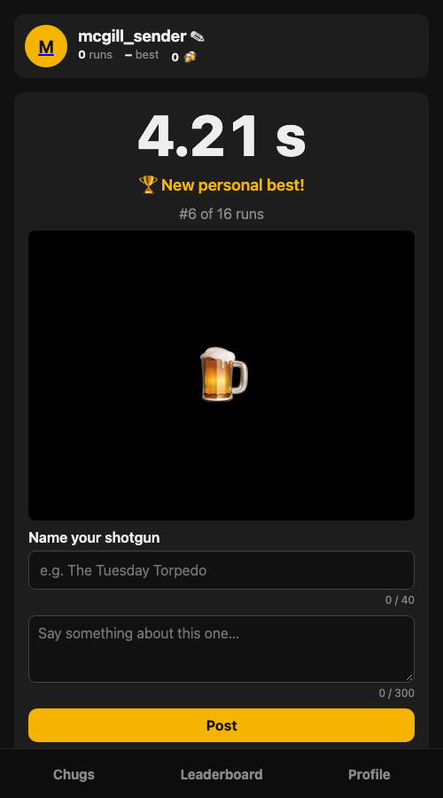
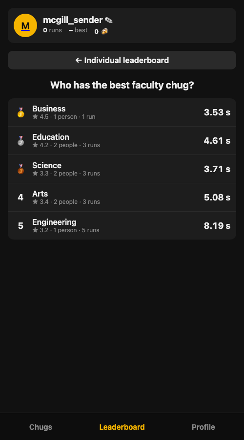
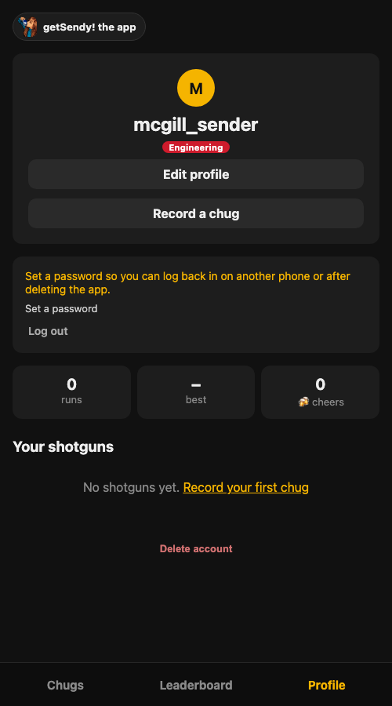

# getSendy! — McGill CodeJam 2026

> Tap **GET SENDY!** and shotgun. Your phone hears the can crack, watches you drink, stops the
> clock when the can leaves your mouth, and you flash a 🤙 to confirm. Then post it, let your
> friends rate it, and climb the individual and **faculty** leaderboards. No stopwatch, no arguing.

**Try it:** **https://getsendy.pages.dev**. Open it on a phone, make a profile, then tap
**Record a chug** and allow the camera and microphone. To install it, go to **Profile →
getSendy! the app** (or Safari → Share → **Add to Home Screen**).

Built in 36 hours at McGill CodeJam 2026 by Anthony Filip and Lana Avdalovic.

| Results | Faculty leaderboard | Profile |
|---|---|---|
|  |  |  |

## What it does

**Timing, hands-free**
- **GET SENDY!** starts recording. The clock starts on its own at the **crack** of the can and
  stops on its own when the **can leaves your mouth**.
- **🤙 to send it.** A shaka confirms the run. The time is set to when the can came down, not
  when your hand went up, so your reaction time doesn't count against you.
- **Front and back camera**, a **light** button (phone flash, or a white ring light on the front
  camera), and **Upload a video**, which is timed by the same rules.

**Fair play**
- A crack only counts **with the can at the drinker's mouth**, so someone opening a can nearby
  is ignored. The drinking motion has to follow, by a **real person** in the shot.
- A 🤙 while the can is still at your mouth is refused.
- The database only accepts runs of **1–120 seconds**, so nobody can post a fake 0.01 s chug.
- **Leaderboard rule:** runs rated **★ 3.5+** by friends rank above the rest, then the fastest
  time wins. Ratings are one per person, final, and you can't rate your own run.

**Social, Instagram-style**
- **Chugs feed:** full-screen videos you swipe up and down, playing with sound.
- **Ratings** (Super poop → Legendary) with a live average next to the time.
- **Comments** in a panel that slides up. Commenters show **Author** or the rating they gave,
  you can **cheer 🍻** a comment, and you can delete your own.
- **Share** the video to Instagram, TikTok or Messages, or **save** it.
- **Profiles:** unique username, photo, **McGill faculty**, and a **password** so you can log
  back in on any phone. Tap anyone to see their page and swipe through their shotguns.
- **Faculty leaderboard: "Who has the best faculty chug?"** Each faculty's runs are averaged.
- **Installable app (PWA):** "Add to Home Screen" gives **getSendy!** its own icon and a
  full-screen launch, with no app store.
- **Delete your account** at any time, which removes your posts, videos, comments and ratings.

## How accurate is it?

We collected **18 real shotgun videos** and labelled the true start (tab pop) and end (can
leaves the mouth) frame by frame. The built-in **detection lab** (`/lab.html`) runs the same
rules as the live tracker on every clip and scores them against those labels.

| Single-person clips (8) | Result |
|---|---|
| Runs found | **8 / 8**, no false starts |
| Start (crack) error | **0.15 s** on average |
| Run time error | **0.15 s** on 7 clips (one clip's end is 1.2 s late) |

**Groups of 2–3 people (10 clips):** all 10 start; 2 start late because the tracker followed
the wrong person. Thresholds were tuned on two separate analyses of the clips, so they aren't
fitted to one run of the model.

**Honest caveats:** 18 clips is a small set; groups are harder; and the live phone build uses a
lighter pose model than the lab measured.

## How it works

Everything runs **in the browser, on the device**. Camera and microphone are never uploaded for
analysis; only the finished clip is, when you post it.

```
camera ──► MediaPipe Pose ──► wrist-to-mouth distance, head tilt, forearm angle ─┐
       └─► MediaPipe hands on zoomed wrist crops ──► 🤙 shaka (3D finger bends)   │
mic ────► loudness + brightness every 20 ms ──► crack / click score             │
                                                                                 ▼
             start + end rules ──► timer ──► results page ──► Supabase feed + leaderboards
```

- **Crack detection:** a sudden, *bright* jump in sound (energy above 3 kHz) compared with the
  half-second just before. Comparing with the moment before, rather than a slow-moving
  background level, is what makes it work at loud parties. Short "clicks" catch quieter cracks.
- **Start rule:** can at the mouth → a crack or click → within 2.5 s, the drinking motion (head
  tips back and forearm swings up) by a real, upright person. The clock is back-dated to the
  sound. No sound, no start.
- **End rule:** the 🤙 confirms. The time stops when the can last left the mouth, refined to
  when the head came forward.
- **Shaka detection:** MediaPipe has no shaka gesture, so we measure how much each finger bends
  in 3D: thumb and pinky straight, the other three curled. This works whichever way the hand faces.

## Security and privacy

- **Supabase** (Postgres + storage) with **row-level security**. Changing your profile, posting,
  deleting, rating and deleting your account go through **server-side functions** that check a
  secret only your device holds.
- **Passwords** are stored only as **bcrypt hashes**; wrong guesses are slowed down.
- **Storage limits:** clips are video only, up to 50 MB; profile photos are images only, up to 2 MB.
- No API secrets are in the repo. The site only carries Supabase's public "publishable" key.

## Run it locally

Requires Node.js 20+.

```
cd app
npm install
npm run dev
```

| Page | URL |
|---|---|
| Chugs feed | http://localhost:5173/feed.html |
| Record a chug | http://localhost:5173 |
| Leaderboard | http://localhost:5173/leaderboard.html |
| Profile | http://localhost:5173/profile.html |
| Results (demo run) | http://localhost:5173/results.html?demo |
| Detection lab (dev tool) | http://localhost:5173/lab.html |

**Shared feed:** without keys, posts are saved in your own browser. To use a shared database,
create a Supabase project, run [`supabase/schema.sql`](supabase/schema.sql) in its SQL editor
(safe to run again), and put its URL and publishable key in `app/.env.local` (never committed):

```
VITE_SUPABASE_URL=...
VITE_SUPABASE_ANON_KEY=...
```

**Detection lab:** `lab.html` loads test clips from `Chug_Examples/`, which is gitignored
because the clips show real people. Label each clip's start and end, then **Analyse all clips &
score** to measure accuracy.

**Deploys:** every push to `main` deploys to Vercel through `.github/workflows/deploy.yml`.

## Project layout

```
app/
  index.html, src/live/      Record a chug: camera, mic, start/end rules, shaka
  src/detect/                shared maths: angles, crack detector, clip-scoring rules
  src/feed/                  feed, results, comments, ratings, profiles, leaderboards, PWA
  lab.html, src/lab/         detection lab + accuracy scoreboard
  public/                    app icons + manifest (installable app)
supabase/schema.sql          tables, security rules, functions and storage
docs/                        status, architecture, Devpost write-up, screenshots
```

## Team

- **Anthony Filip:** detection, including camera and mic tracking, the crack and click
  detectors, the shaka detector, the accuracy lab and the Record screen.
- **Lana Avdalovic:** the first version of the tracker, then the social app, including the feed, results, comments, ratings, profiles
  and passwords, the leaderboards (individual and faculty), Supabase, the installable app and
  deploys.

## What's next

App Store / Google Play builds (wrapping the same code with Capacitor), following the right
person in group videos, head-to-head challenges, and spill detection.

## Built with

JavaScript · TypeScript · React · Vite · MediaPipe Tasks Vision (pose and hand landmarks) ·
Web Audio API · Supabase (Postgres, storage, row-level security) · Vercel · GitHub Actions
